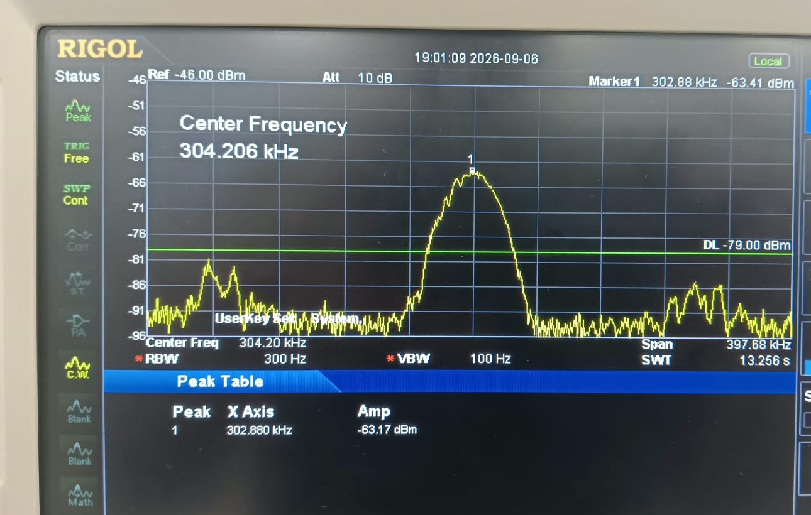
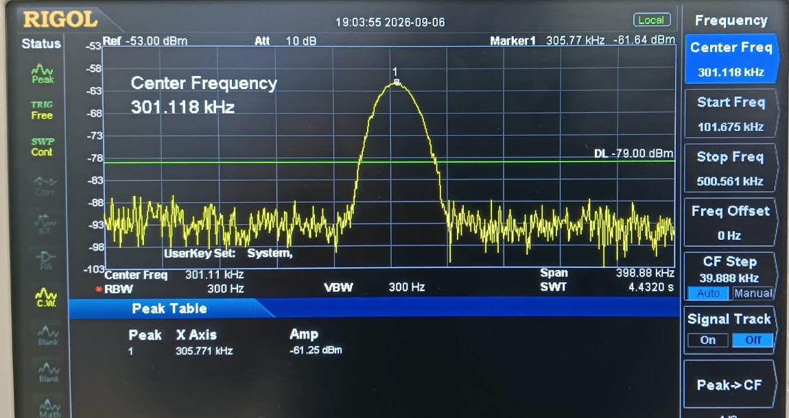
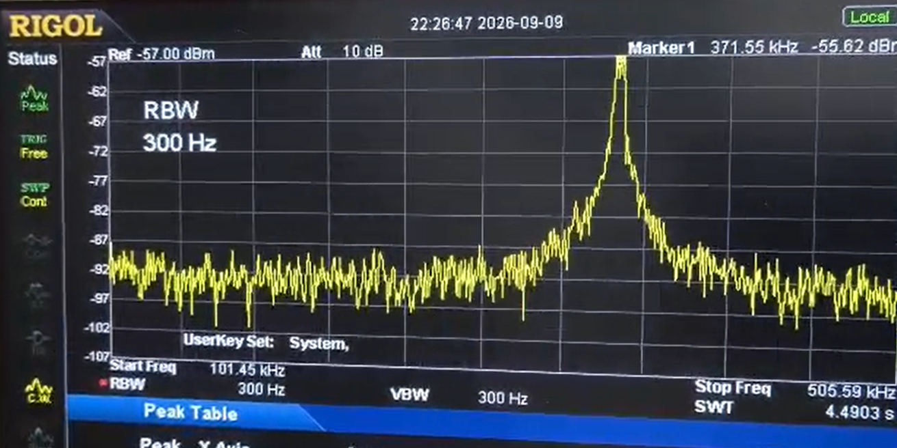

# STM32 Adaptive Sonar Waveform Demo

**Platform:** STM32F446RE &nbsp;|&nbsp; **Toolchain:** STM32CubeIDE / STM32 HAL &nbsp;|&nbsp; **Language:** C

Firmware for an STM32F446RE that generates adaptive sonar-style pulses on the
12-bit DAC and displays the current modulation mode and analog sensor readings
on an SSD1306 OLED. Three modulation types - LFM chirp, geometric sweep, and a
Barker-7 phase-coded pulse - are generated through one code path and adapted
from two analog sensor inputs.

> **Scope note:** This is a waveform-generation and sensor-response demo, not a
> complete sonar ranging system. It does not acquire echoes or calculate
> distance from a transducer. The displayed depth is derived from analog input
> voltage, not a return-time measurement.

---

## Contents

- [Results](#results)
- [Features](#features)
- [Hardware](#hardware)
- [Waveform behavior](#waveform-behavior)
- [Build and flash](#build-and-flash)
- [Project layout](#project-layout)
- [Known limitations](#known-limitations)

---

## Results

### Predicted vs. designed waveform shape

Time-domain envelopes and frequency-domain spectra computed from the firmware
phase equations for all three modulation types:


### Captured spectrum (oscilloscope and spectrum analyzer FFT)

Spectrum captures of the DAC output through the analog conditioning stage, one
trace per modulation type:

| LFM chirp | Geometric sweep | Barker-7 |
|:---:|:---:|:---:|
|  |  |  |

Add oscilloscope time-domain traces and a photo of the OLED as the project
evolves; `assets/` keeps project images together with these plots.

---

## Features

- Timer-triggered DAC output with circular DMA at a 1 MHz sample rate.
- Three selectable waveforms: linear-frequency-modulated (LFM) chirp,
	geometric-frequency sweep, and Barker-7 phase-coded pulse, dispatched through
	one function and switchable live with a button press.
- Hamming-windowed pulses with adaptive frequency, duration, and amplitude.
- Periodic two-channel ADC sampling for normalized turbidity and estimated
	depth values.
- 128 x 64 SSD1306 OLED over I2C, showing the active mode and sensor readings.
- PC13 user button cycles through waveform modes.
- The core waveform generator has no STM32/HAL dependencies and can be built
	and tested on a host computer.

## Hardware

| Function | STM32F446RE connection | Notes |
| --- | --- | --- |
| Turbidity analog input | PA0 / ADC1_IN0 | 0-3.3 V maps to 0-100% |
| Depth analog input | PA1 / ADC1_IN1 | 0-3.3 V maps to 0-200 m |
| Waveform output | PA4 / DAC_OUT1 | 12-bit DAC; add signal conditioning and a proper driver before any transducer |
| OLED SCL | PB6 / I2C1_SCL | SSD1306, address 0x3C |
| OLED SDA | PB7 / I2C1_SDA | SSD1306, address 0x3C |
| Mode button | PC13 / EXTI13 | Falling-edge press cycles modes |

Keep analog sensor outputs within the MCU's 0-3.3 V input range. **Do not
connect a transducer directly to PA4**; use an appropriate driver and
protection circuit. I2C1 is configured on PB6/PB7 in the generated HAL MSP
code (`Core/Src/stm32f4xx_hal_msp.c`), while `main.c` also initializes PB8/PB9
as I2C1 alternate-function pins. Verify the physical OLED pin pair and the
generated configuration, especially after regenerating the project from
CubeMX.

## Waveform behavior

ADC samples are normalized as follows:

- **PA0:** ADC count / 4095 maps turbidity from 0.0 (clear) to 1.0 (very turbid).
- **PA1:** ADC count / 4095 x 200 maps depth from 0 to 200 m.

These inputs feed an adaptive difficulty score that adjusts the waveform
frequency band (100-500 kHz), pulse duration (0.5-5 ms), and amplitude. The
difficulty calculation includes a term derived from Thorp's acoustic
absorption equation, but treats depth as a proxy for one-way range and uses a
placeholder 20 dB loss bound. These are modeling assumptions, not calibrated
measurements. The ADC inputs need sensors or signal conditioning that produce
voltages in the expected ranges above.

## Build and flash

1. Install STM32CubeIDE with the STM32F4 firmware package this project targets
	 (STM32Cube FW_F4 V1.28.3).
2. Import the repository as an existing STM32CubeIDE project, or open
	 `sonar_test.ioc` in STM32CubeMX / STM32CubeIDE.
3. Select the `Debug` or `Release` build configuration and build the
	 `sonar_test` target.
4. Connect an STM32F446RE board over ST-LINK, then use **Run** or **Debug** in
	 STM32CubeIDE to program it.

The project uses the STM32 HAL and GCC toolchain. `Debug/` and `Release/`
contain generated build outputs; rebuild them locally for your own toolchain
and configuration rather than relying on committed copies.

### Host-side test (no hardware required)

`Core/Src/waveform_gen.c` has no STM32/HAL dependency. Build and run the host
test from the repository root with GCC:

```sh
gcc -O2 -Wall -Wextra -ICore/Inc -o test_wavegen tests/test_wavegen.c Core/Src/waveform_gen.c -lm
./test_wavegen
```

On Windows PowerShell, run the generated executable as `.\test_wavegen.exe`.
For firmware changes, compare samples against a Python double-precision
reference before relying on real hardware; this workflow previously caught a
missing duration-scaling factor in the geometric sweep phase formula.

## Project layout

```text
Core/
	Inc/    main.h, waveform_gen.h, oled_ssd1306.h, font5x7.h
	Src/    main.c, waveform_gen.c, oled_ssd1306.c
					peripheral setup, ADC processing, DMA callbacks, OLED UI, button handling
Drivers/               STM32F4 HAL and CMSIS dependencies
tests/                 Host-side waveform generator test
assets/                Predicted waveform plot and spectrum captures
sonar_test.ioc          STM32CubeMX peripheral and pin configuration
STM32F446RETX_FLASH.ld  Linker script (Flash)
STM32F446RETX_RAM.ld    Linker script (RAM)
```

- `Core/Src/waveform_gen.c` and `Core/Inc/waveform_gen.h`: adaptive parameter
	mapping and waveform lookup-table generation for all three modulation types.
- `Core/Src/oled_ssd1306.c` and `Core/Inc/oled_ssd1306.h`: minimal SSD1306
	display driver with no external library dependency.

## Known limitations

- **Sensor inputs are analog proxies, not calibrated instruments.** Turbidity
	and depth are derived from analog voltages; there is no calibration layer
	between a real sensor and the ADC's expected 0-3.3 V range.
- **The difficulty model includes placeholder assumptions.** Thorp absorption
	provides a physics-based term, but the 20 dB acceptable-loss bound and use of
	depth as a one-way-range proxy have not been calibrated by measurement.
- **I2C1 GPIO is configured in two places.** The HAL MSP configures PB6/PB7,
	while `main.c` also configures PB8/PB9. Confirm the intended pins and keep
	CubeMX and application initialization consistent.
- **No transducer driver stage is included.** PA4's DAC output needs suitable
	external buffering, filtering, and amplification before driving a
	transducer.
