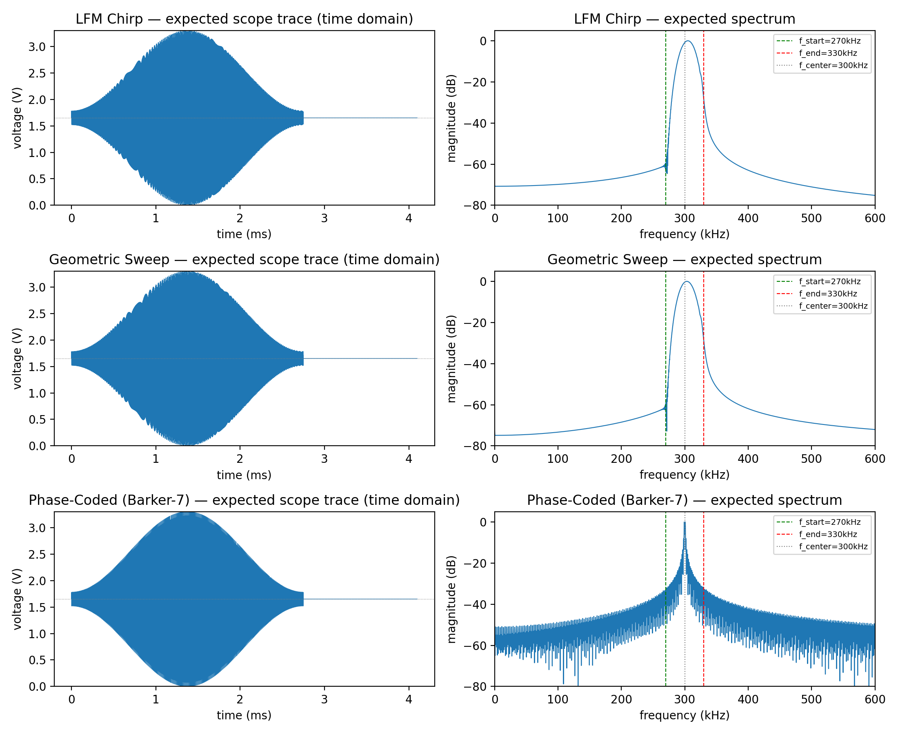
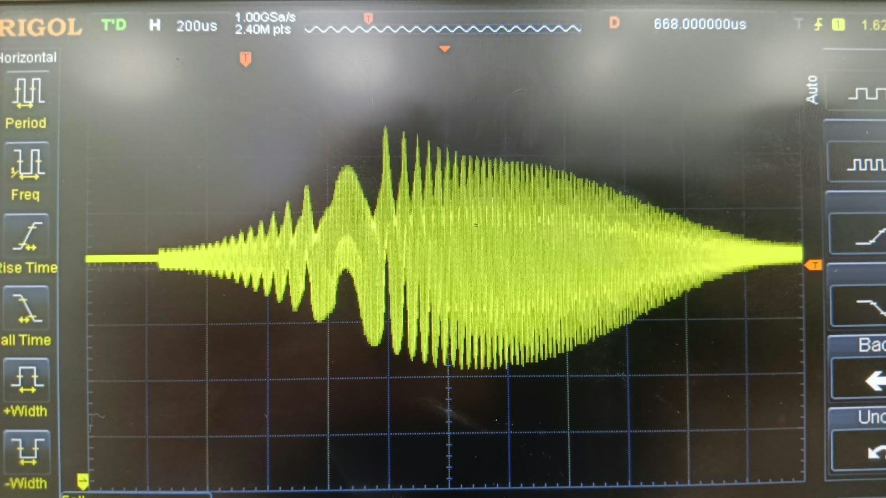
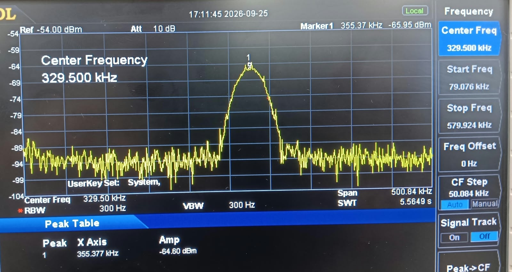
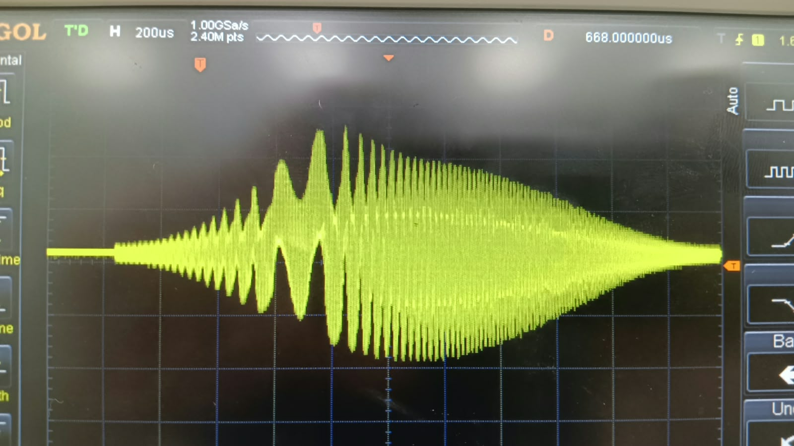
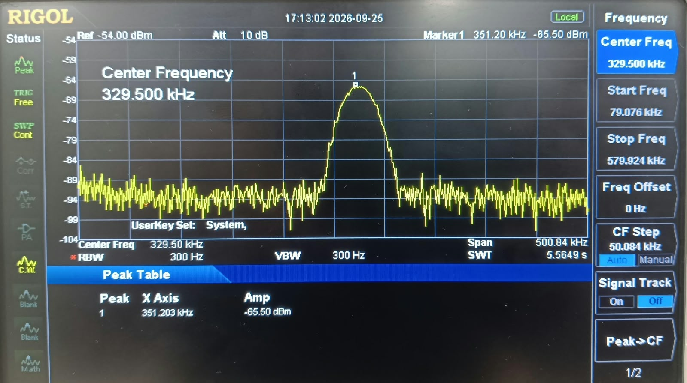
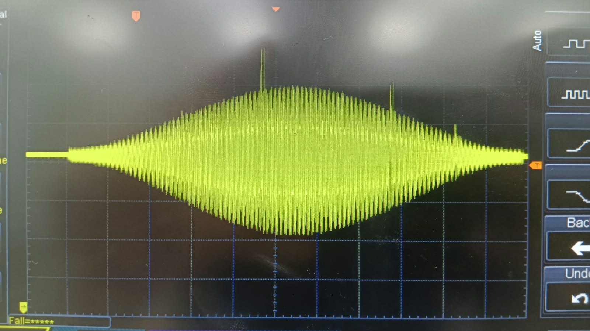
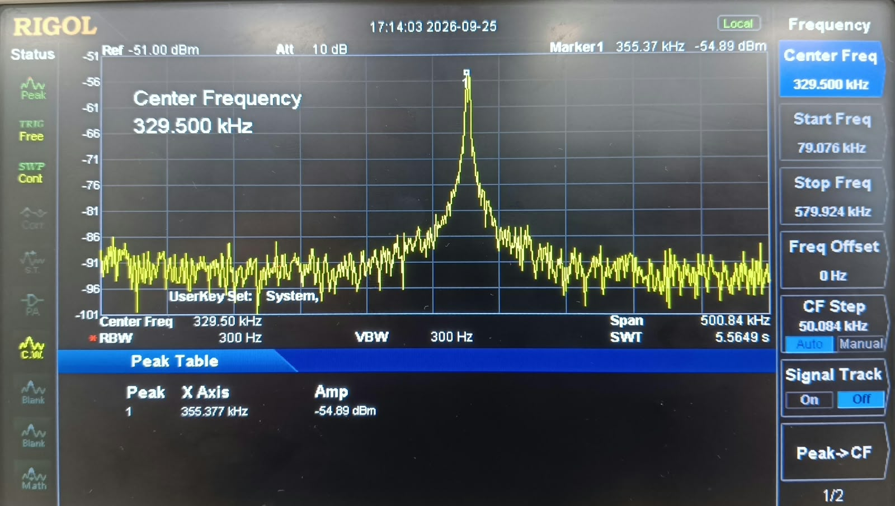

<p align="center">
	
</p>

# STM32 Adaptive Sonar Waveform Demo

<p align="center"><strong>Built by Team Matsya</strong></p>

**Platform:** STM32F446RE &nbsp;|&nbsp; **Toolchain:** STM32CubeIDE / STM32 HAL &nbsp;|&nbsp; **Language:** C

Firmware for an STM32F446RE that generates adaptive sonar-style pulses on the
12-bit DAC and displays the current modulation mode and analog sensor readings
on an SSD1306 OLED. Three modulation types - LFM chirp, geometric sweep, and a
Barker-7 phase-coded pulse - are generated through one code path and adapted
from two analog sensor inputs.

> **Scope note:** This is a waveform-generation and sensor-response demo, not a
> complete sonar ranging system. It does not acquire echoes or calculate
> distance from a transducer. The displayed depth is derived from analog input
> voltage, not a return-time measurement.

---

## Contents

- [Results](#results)
- [Features](#features)
- [Hardware](#hardware)
- [Waveform behavior](#waveform-behavior)
- [Mathematical model and firmware flow](#mathematical-model-and-firmware-flow)
- [Build and flash](#build-and-flash)
- [Project layout](#project-layout)
- [Known limitations](#known-limitations)
- [References](#references)

---

## Results

### Predicted vs. designed waveform shape

Time-domain envelopes and frequency-domain spectra computed from the firmware
phase equations for all three modulation types:



### Hardware captures

Oscilloscope time-domain traces and spectrum-analyzer captures of the DAC
output, grouped by modulation type:

| Waveform | Oscilloscope | Spectrum analyzer |
| --- |:---:|:---:|
| LFM chirp |  |  |
| Geometric sweep |  |  |
| Barker-7 |  |  |

Add a photo of the OLED status display as the project evolves; `assets/`
keeps project images together with these captures and the predicted plot.

---

## Features

- Timer-triggered DAC output with circular DMA at a 1 MHz sample rate.
- Three selectable waveforms: linear-frequency-modulated (LFM) chirp,
	geometric-frequency sweep, and Barker-7 phase-coded pulse, dispatched through
	one function and switchable live with a button press.
- Hamming-windowed pulses with adaptive frequency, duration, and amplitude.
- Periodic two-channel ADC sampling for normalized turbidity and estimated
	depth values.
- 128 x 64 SSD1306 OLED over I2C, showing the active mode and sensor readings.
- PC13 user button cycles through waveform modes.
- The core waveform generator has no STM32/HAL dependencies and can be built
	and tested on a host computer.

## Hardware

| Function | STM32F446RE connection | Notes |
| --- | --- | --- |
| Turbidity analog input | PA0 / ADC1_IN0 | 0-3.3 V maps to 0-100% |
| Depth analog input | PA1 / ADC1_IN1 | 0-3.3 V maps to 0-200 m |
| Waveform output | PA4 / DAC_OUT1 | 12-bit DAC; add signal conditioning and a proper driver before any transducer |
| OLED SCL | PB6 / I2C1_SCL | SSD1306, address 0x3C |
| OLED SDA | PB7 / I2C1_SDA | SSD1306, address 0x3C |
| Mode button | PC13 / EXTI13 | Falling-edge press cycles modes |

Keep analog sensor outputs within the MCU's 0-3.3 V input range. **Do not
connect a transducer directly to PA4**; use an appropriate driver and
protection circuit. I2C1 is configured on PB6/PB7 in the generated HAL MSP
code (`Core/Src/stm32f4xx_hal_msp.c`), while `main.c` also initializes PB8/PB9
as I2C1 alternate-function pins. Verify the physical OLED pin pair and the
generated configuration, especially after regenerating the project from
CubeMX.

## Waveform behavior

ADC samples are normalized as follows:

- **PA0:** ADC count / 4095 maps turbidity from 0.0 (clear) to 1.0 (very turbid).
- **PA1:** ADC count / 4095 x 200 maps depth from 0 to 200 m.

These inputs feed an adaptive difficulty score that adjusts the waveform
frequency band (100-500 kHz), pulse duration (0.5-5 ms), and amplitude. The
difficulty calculation includes a term derived from Thorp's acoustic
absorption equation, but treats depth as a proxy for one-way range and uses a
placeholder 20 dB loss bound. These are modeling assumptions, not calibrated
measurements. The ADC inputs need sensors or signal conditioning that produce
voltages in the expected ranges above.

## Mathematical model and firmware flow

The equations below describe the implementation in
`Core/Src/waveform_gen.c`; sensor scaling and peripheral scheduling are in
`Core/Src/main.c`.

### Sensor inputs and adaptive parameters

For the 12-bit ADC readings $A_0$ and $A_1$, the firmware uses:

$$
u = \operatorname{clamp}\left(\frac{A_0}{4095}, 0, 1\right),
\qquad
d = 200\,\frac{A_1}{4095}\ \text{m}.
$$

Here $u$ is the normalized turbidity input and $d$ is the estimated depth. The
depth-normalized and absorption terms are:

$$
d_n = \operatorname{clamp}\left(\frac{d}{200}, 0, 1\right),
\qquad
\alpha(f) =
\frac{0.11 f^2}{1+f^2}
+ \frac{44 f^2}{4100+f^2}
+ 2.75\times10^{-4} f^2 + 0.003
\quad \text{dB/km},
$$

where $f$ is in kHz. The firmware evaluates Thorp absorption at 500 kHz and
uses depth as an estimated one-way range:

$$
L = \alpha(500)\,\frac{\operatorname{clamp}(d,1,200)}{1000},
\qquad
a = \operatorname{clamp}\left(\frac{L}{20},0,1\right),
$$

where $L$ is estimated loss in dB and $a$ is the normalized absorption
difficulty. The combined difficulty and waveform parameters are:

$$
D = \operatorname{clamp}(0.35u + 0.15d_n + 0.50a, 0, 1),
\qquad
f_c = 500\text{ kHz} - D(400\text{ kHz}),
$$

$$
B = 0.2 f_c,\qquad f_0=f_c-\frac{B}{2},\qquad f_1=f_c+\frac{B}{2},
$$

$$
T = 0.5\text{ ms} + D(4.5\text{ ms}),
\qquad
A = 0.2 + 0.8D.
$$

The 20 dB normalization bound and depth-as-range assumption are placeholders,
not measured link-budget parameters.

The same conversion and update path appears in the main loop's ADC task:

```c
float turbidity = (float)turb_raw / 4095.0f;
float depth_m = ((float)depth_raw / 4095.0f) * 200.0f;

sonar_params_t p = sonar_adaptive_params(turbidity, depth_m);
g_current_params = p;
g_params_dirty = 1;
```

### Pulse equations and DAC encoding

All three pulses use a Hamming envelope $w_i$ over $N$ samples:

$$
w_i = 0.54 - 0.46\cos\left(\frac{2\pi i}{N-1}\right),
\qquad 0\le i<N.
$$

For an LFM chirp, the frequency changes linearly from $f_0$ to $f_1$ over
duration $T$. With $k=(f_1-f_0)/T$:

$$
\phi_{\mathrm{LFM}}(t)=2\pi\left(f_0t+\frac{k t^2}{2}\right),
\qquad
s(t)=A\,w(t)\sin\bigl(\phi_{\mathrm{LFM}}(t)\bigr).
$$

For the geometric (logarithmic) sweep, $r=f_1/f_0$ and instantaneous frequency
is $f(t)=f_0r^{t/T}$. Integrating frequency gives the phase used by the code:

$$
\phi_{\mathrm{geo}}(t)=
2\pi f_0T\,\frac{r^{t/T}-1}{\ln r},
\qquad
s(t)=A\,w(t)\sin\bigl(\phi_{\mathrm{geo}}(t)\bigr).
$$

The factor $T$ is required by the phase integral. For the Barker-7 pulse, the
carrier is $f_c=(f_0+f_1)/2$ and the chip sequence is
$[+1,+1,+1,-1,-1,+1,-1]$:

$$
s_i=A\,w_i\,c_i\sin(2\pi f_ct_i),
\qquad t_i=\frac{i}{f_s}.
$$

For an ideal length-$N$ Barker code, the peak sidelobe amplitude is $1/N$ of
the main peak. Barker-7 therefore has an ideal peak-sidelobe suppression
magnitude of

$$
20\log_{10}(N)=20\log_{10}(7)\approx16.9\text{ dB}.
$$

This is a code property, not a measured performance claim for the hardware,
transducer, or acoustic channel.

The sample is centered and quantized for the unsigned 12-bit DAC. The buffer
tail is filled with midscale (silence):

$$
\mathrm{DAC}_i = \operatorname{clamp}\left[
\left(\frac{s_i}{2}+\frac{1}{2}\right)4095,\,0,\,4095\right],
\qquad \mathrm{DAC}_{i\ge N}=2048.
$$

For the 180 MHz system clock, the APB1 timer clock is 90 MHz. TIM6 uses
prescaler 0 and period 89, so the DAC sample rate is:

$$
f_s=\frac{90\text{ MHz}}{(0+1)(89+1)}=1\text{ MHz}.
$$

The lookup-table dispatcher selects the generator from the current modulation
mode; DMA half/full callbacks refill the corresponding buffer half when
parameters change:

```c
uint32_t written = sonar_fill_waveform(
	dac_buffer, HALF_BUF_SAMPLES, &g_current_params,
	g_sample_rate_hz, WINDOW_HAMMING, g_current_mode);
```

TIM7 runs at 20 Hz and requests an ADC refresh by setting a flag. The main loop
performs the two ADC conversions, adapts the waveform, and requests an OLED
refresh; display writes are rate-limited to 50 ms. The PC13 interrupt advances
the modulation mode.

## Build and flash

1. Install STM32CubeIDE with the STM32F4 firmware package this project targets
	 (STM32Cube FW_F4 V1.28.3).
2. Import the repository as an existing STM32CubeIDE project, or open
	 `sonar_test.ioc` in STM32CubeMX / STM32CubeIDE.
3. Select the `Debug` or `Release` build configuration and build the
	 `sonar_test` target.
4. Connect an STM32F446RE board over ST-LINK, then use **Run** or **Debug** in
	 STM32CubeIDE to program it.

The project uses the STM32 HAL and GCC toolchain. `Debug/` and `Release/`
contain generated build outputs; rebuild them locally for your own toolchain
and configuration rather than relying on committed copies.

### Host-side test (no hardware required)

`Core/Src/waveform_gen.c` has no STM32/HAL dependency. Build and run the host
test from the repository root with GCC:

```sh
gcc -O2 -Wall -Wextra -ICore/Inc -o test_wavegen tests/test_wavegen.c Core/Src/waveform_gen.c -lm
./test_wavegen
```

On Windows PowerShell, run the generated executable as `.\test_wavegen.exe`.
For firmware changes, compare samples against a Python double-precision
reference before relying on real hardware; this workflow previously caught a
missing duration-scaling factor in the geometric sweep phase formula.

## Project layout

```text
Core/
	Inc/    main.h, waveform_gen.h, oled_ssd1306.h, font5x7.h
	Src/    main.c, waveform_gen.c, oled_ssd1306.c
					peripheral setup, ADC processing, DMA callbacks, OLED UI, button handling
Drivers/               STM32F4 HAL and CMSIS dependencies
tests/                 Host-side waveform generator test
assets/                Predicted waveform plot and spectrum captures
assets/matsya.png       Team Matsya logo
sonar_test.ioc          STM32CubeMX peripheral and pin configuration
STM32F446RETX_FLASH.ld  Linker script (Flash)
STM32F446RETX_RAM.ld    Linker script (RAM)
```

- `Core/Src/waveform_gen.c` and `Core/Inc/waveform_gen.h`: adaptive parameter
	mapping and waveform lookup-table generation for all three modulation types.
- `Core/Src/oled_ssd1306.c` and `Core/Inc/oled_ssd1306.h`: minimal SSD1306
	display driver with no external library dependency.

## Known limitations

- **Sensor inputs are analog proxies, not calibrated instruments.** Turbidity
	and depth are derived from analog voltages; there is no calibration layer
	between a real sensor and the ADC's expected 0-3.3 V range.
- **The difficulty model includes placeholder assumptions.** Thorp absorption
	provides a physics-based term, but the 20 dB acceptable-loss bound and use of
	depth as a one-way-range proxy have not been calibrated by measurement.
- **I2C1 GPIO is configured in two places.** The HAL MSP configures PB6/PB7,
	while `main.c` also configures PB8/PB9. Confirm the intended pins and keep
	CubeMX and application initialization consistent.
- **No transducer driver stage is included.** PA4's DAC output needs suitable
	external buffering, filtering, and amplification before driving a
	transducer.

## References

1. STMicroelectronics, [How to use DAC for audio and waveform generation on STM32 MCUs and MPUs](https://cgit.pinealservo.com/BluePill_Rust/resources/raw/commit/c49f0c9fe83484570a9c03ebb85176b403aa46c/STM32%20Manuals/STM32_Audio_DAC_AppNote.pdf).
2. [On the Relationship between Transmission Power and Capacity of Underwater Acoustic Communication Channel](https://arxiv.org/pdf/0801.0426).
3. Ahmed et al., [Monostatic Sonar Performance Using Pulse Compression Waveforms](https://arl.nus.edu.sg/wp-content/publications/Ahmed2018Oceans.pdf), IEEE OCEANS (via ARL/NUS).
4. ScienceDirect Topics, [Side Scan Sonar: An Overview](https://www.sciencedirect.com/topics/engineering/side-scan-sonar).
5. [Enhanced target detection using a new cognitive sonar waveform design in shallow water](https://www.sciencedirect.com/science/article/abs/pii/S0003682X23000683), Applied Acoustics.
6. W. H. Thorp, "Analytic description of the low-frequency attenuation coefficient," *The Journal of the Acoustical Society of America*, vol. 42, no. 1, p. 270, 1967. https://doi.org/10.1121/1.1910566.

References 1-5 provide implementation background for STM32 DAC output,
underwater acoustic channels, pulse compression, and sonar waveforms. The
adaptive constants and placeholder link-budget assumptions in this firmware
are project choices, not values validated by those references.
